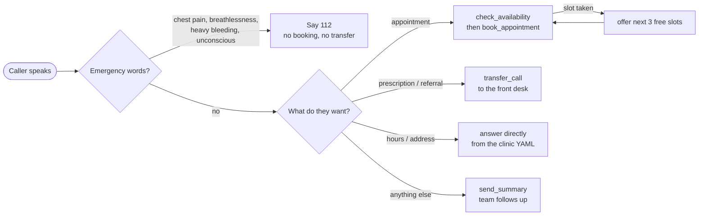

# Hamza Clinic Voice Agent

A phone receptionist for clinics, built on [Vapi](https://vapi.ai) and FastAPI. It answers in German,
books real appointment slots, sends emergencies to 112, hands prescription calls to the front desk and
mails the team a summary. One YAML file describes a clinic; there is no code to change for the next one.

> The three clinics in `configs/examples/` are fictional demo data. Nothing here has been run for a real practice.

---

## Listen to one call

A booking call as it is designed to run, shown from both sides: the phone on the left, the server on the right.
The spoken lines are illustrative; the tool calls and replies are exactly what the handlers produce.

| Caller | Agent | Server side |
|---|---|---|
| *Hallo, ich hätte gern einen Termin, morgen Vormittag.* | Asks: new or existing patient? | – |
| *Neu. Thomas Schneider, Rückenschmerzen.* | "Moment, ich schaue nach freien Zeiten." | `check_availability(date="2026-04-14", earliest_time="08:00")` |
| | "Morgen hätte ich 09:00, 09:30 oder 10:00 Uhr." | → `Freie Termine am Dienstag, 14.04.2026: 08:00, 08:30, …` |
| *Halb zehn bitte.* | "Ich trage das ein." | `book_appointment(…, time="09:30", is_new_patient=true)` |
| | "Dienstag, 14. April, 9:30 Uhr. Ist notiert." | → `Termin erfolgreich gebucht …` (slot is now taken) |
| *Danke, tschüss.* | Says goodbye, hangs up. | `send_summary(…)` then `end-of-call-report` |

If a second caller asks for 09:30, the server answers with the three next free slots instead of
double-booking, and the agent offers those. Ask for a public holiday and it says the practice is closed and why.

---

## Try it in two minutes (no accounts, no network)

```bash
python -m venv .venv && source .venv/bin/activate     # Windows: .venv\Scripts\activate
pip install -r requirements-dev.txt

python scripts/run_scenarios.py                       # replay 5 scripted calls against the handlers
python -m pytest                                      # run the test suite
python -m app.main                                    # start the server on :8000
```

Then open <http://localhost:8000/dashboard> or <http://localhost:8000/docs>.

`run_scenarios.py` sends the exact webhook traffic each scenario should produce and checks the replies.
It proves the server side. It cannot judge what the LLM says; only a real call does that.

Try another clinic: `python scripts/run_scenarios.py --config configs/examples/physiotherapy_hamburg.yaml`

---

## Put it on a real phone number

1. **Keys.** `cp .env.example .env`, then set `VAPI_API_KEY` and a random `VAPI_WEBHOOK_SECRET`.
2. **Public URL.** `ngrok http 8000` (or deploy, see below). Start the server with `python -m app.main`.
3. **Preview, then create.**
   ```bash
   python scripts/setup_vapi.py --webhook-url https://YOUR-URL --dry-run            # prints every payload, calls nothing
   python scripts/setup_vapi.py --webhook-url https://YOUR-URL --webhook-secret "$VAPI_WEBHOOK_SECRET" --phone-number
   ```
4. **Call it** and say *"Ich hätte gerne einen Termin."*

Want the holiday / after-hours greeting to be decided **per call** instead of when you created the assistant?
Use `--dynamic-greeting`, put the printed assistant id into `VAPI_ASSISTANT_ID`, and give the phone number a
Server URL instead of an assistant in the Vapi dashboard. Vapi then asks the server who should answer each call.

> The payload formats follow Vapi's current server-message docs, and the model name defaults to
> `claude-sonnet-5-5`. If Vapi rejects a model or voice name on your account, set `LLM_MODEL`, `VOICE_ID`
> or `STT_MODEL` in `.env`; nothing is hard-coded.

---

## How the agent decides

One map, from the first sentence to the action. The rules live in the system prompt
(`app/agent.py`); the boxes on the right are the server tools in `app/handlers.py`.



---

## What changed from the starter

This project grew out of a small open-source Vapi starter. Reading it closely turned up problems that only
show up on a real phone line; these are the fixes.

| Problem in the starter | What happens now |
|---|---|
| The greeting was computed once, when the assistant was created, so "holiday / after hours" never changed | `--dynamic-greeting` builds it per call through Vapi's `assistant-request` |
| Bookings on public holidays were accepted | Holidays and clinic closures return no slots |
| Holidays were a hand-typed 2026 list | Computed from the Easter date for any year, per region (Bavaria, Berlin, Hamburg, nationwide) |
| The agent could only *try* to book; it had no way to list free times | New `check_availability` tool, and the prompt forbids inventing times |
| The model did not know today's date, so "tomorrow" was a guess | The prompt carries a Vapi date template in the clinic's timezone |
| Speech-to-text used Vapi's default (English) for German callers | Transcriber is set to Deepgram with `language: de` |
| Server clock was used for hours, so a UTC host greeted people wrongly | Everything runs in the clinic's `timezone` |
| The handler ignored whether the booking write succeeded, so a lost race still told the caller "booked" | Check and write happen under one lock and the result decides the answer; the file is replaced atomically |
| A malformed date or time caused a 500, and past dates could be booked | The model gets a short German sentence saying what to fix |
| A crashing tool left the caller in silence | A polite "technical problem" sentence is returned instead |
| Vapi's newer `tool-calls` message was not handled | Handled, with the old `function-call` format still supported |
| All clinics shared one hours file, so the dentist inherited the GP's hours | Each clinic YAML is self-contained; spoken hours are generated from it |
| `.env.example` listed variables the code never reads | Rewritten to match the code exactly |
| Dockerfile left out the dashboard and ran as root, and Fly had no volume for `data/` | Dashboard included, non-root user, healthcheck, volumes for `data/` |
| Booking rate divided bookings by *tool calls* and counted failed attempts | Bookings ÷ completed calls, successful bookings only |

---

## Make it yours

Copy `configs/clinic_template.yaml`, edit it, point `CLINIC_CONFIG` at it. Opening hours are the single source
of truth for slots, greeting and the spoken hours:

```yaml
clinic_name: "Praxis Dr. Mustermann"
transfer_number: "+491234567890"        # E.164, Vapi requires it
office_hours:
  monday:   ["08:00-12:00", "14:00-18:00"]
  saturday: []                          # closed
holiday_region: "BY"                    # FEDERAL | BY | BE | HH
closed_days:
  - { date: "2026-08-10", name: "Betriebsurlaub" }
```

A bad file fails at start-up with a message that names the missing or invalid field.

### Settings

| Variable | Default | Meaning |
|---|---|---|
| `VAPI_API_KEY` | – | Needed by `setup_vapi.py` and `--live` only |
| `VAPI_WEBHOOK_SECRET` | – | When set, unsigned webhook calls get `401` |
| `VAPI_ASSISTANT_ID` | – | For `--dynamic-greeting` |
| `CLINIC_CONFIG` | Munich demo | Clinic YAML to use |
| `CLINIC_TRANSFER_NUMBER` | from YAML | Override the transfer number |
| `DATA_DIR` | `data` | Where `bookings.json` and `call_log.jsonl` live |
| `LLM_PROVIDER` / `LLM_MODEL` | `anthropic` / `claude-sonnet-5-5` | Model Vapi uses |
| `VOICE_PROVIDER` / `VOICE_ID` / `VOICE_MODEL` | `11labs` / Rachel / `eleven_multilingual_v2` | Voice |
| `STT_PROVIDER` / `STT_MODEL` / `STT_LANGUAGE` | `deepgram` / `nova-3` / `de` | Speech recognition |
| `DASHBOARD_TOKEN` | – | When set, `/api/analytics` needs `Authorization: Bearer …` |
| `SMTP_*`, `NOTIFICATION_EMAIL_*`, `NOTIFICATION_WEBHOOK_URL` | – | Where `send_summary` delivers (email, Slack, n8n, Make…) |
| `HOST`, `PORT`, `DEBUG` | `0.0.0.0`, `8000`, `false` | Server |

### Deploy

```bash
docker compose up --build                                   # local, data in a named volume

fly volumes create clinic_data --region fra --size 1        # once
fly secrets set VAPI_WEBHOOK_SECRET=... DASHBOARD_TOKEN=... # plus SMTP_* if you want email
fly deploy
```

---

## Project map

```
app/        agent.py (prompt, greeting, tool schemas)   handlers.py (webhook logic, no framework)
            availability.py (slots, bookings)           clinic.py (YAML → validated config)
            holidays.py   analytics.py   notifications.py   security.py   server.py   main.py
configs/    clinic_template.yaml   scenarios.yaml   examples/ (Munich GP, Berlin dentist, Hamburg physio)
scripts/    setup_vapi.py (create tools + assistant, --dry-run)   run_scenarios.py (offline replay or live)
dashboard/  index.html          docs/  webhook-api.md          tests/  one file per module
```

Full endpoint and payload reference: [`docs/webhook-api.md`](docs/webhook-api.md).

---

## Know before you use it

* **Storage is a JSON file.** Correct for one worker (the lock is in-process). Run several workers or machines and
  you need a database; `BookingStore` in `app/availability.py` is the one class to replace.
* **Logs contain names and booking reasons.** That is personal, health-adjacent data. Decide retention, restrict
  access to `data/`, set `DASHBOARD_TOKEN`, and check Vapi's recording and data-processing settings
  (GDPR / data-processing agreement) before using real patient calls.
* **It is an assistant, not a triage system.** The emergency rule is a prompt instruction, not a medical device.
  Test it with your own phrasing, and keep a human fallback number configured.
* **Live behaviour needs a live call.** The offline replay and unit tests cover the server; the voice, the
  model and Vapi's own formats are only exercised by real calls.

